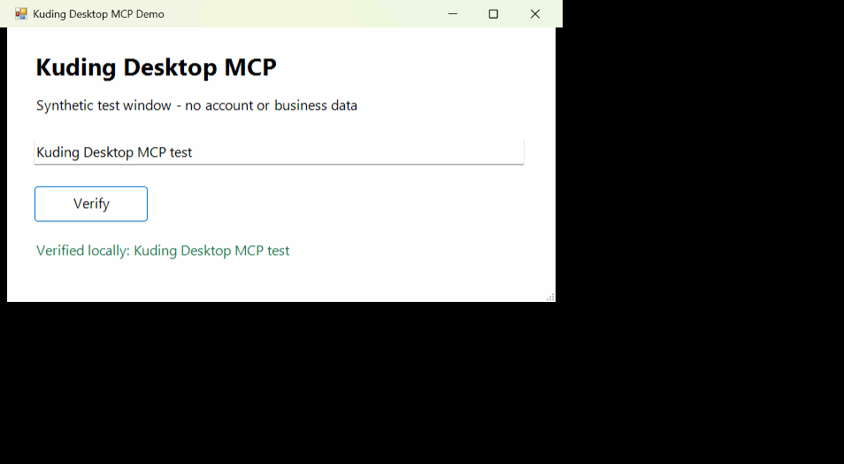

# Kuding Desktop MCP

**English** | [简体中文](README.zh-CN.md)

Windows desktop inspection, interaction, and verification for MCP-capable AI assistants. An MIT-licensed derivative of [CursorTouch/Windows-MCP](https://github.com/CursorTouch/Windows-MCP), pinned to upstream **0.8.5**, with scoped UI Automation, local OCR, window-aware input checks, and local-only diagnostics.

## Why this exists

When development began, we already used ChatGPT's computer-control tools. Our WorkBuddy setup did not yet provide a dedicated desktop-control plugin or MCP. We wanted a reusable Windows automation layer for other MCP-capable clients, and a way to improve application-specific behavior ourselves.

The project grew through real desktop tasks: Power BI controls, exports from an application without a suitable API, and custom-drawn chat interfaces. It complements first-party computer-use tools while respecting the AI client's own permissions and approval rules. [Read the development story in Chinese](docs/introduction.zh-CN.md).

## Capabilities

- Inspect accessible controls and text; scope searches to a process or window.
- Use native UIA actions and value setting, with mouse/keyboard fallbacks.
- Read text with Windows local OCR when accessibility data is incomplete.
- Capture individual windows and return explicit scale/coordinate information.
- Check window ownership for screenshot-derived input; observe changes after acting.
- Coordinate compatible MCP instances sharing one desktop and yield to human input.
- Provide an operation indicator, Esc interruption, and a reusable desktop-operation skill.

Tool schemas are discoverable through MCP. Window/frame checks do not detect every content change, coordinate locks cannot coordinate unrelated third-party automation, and Esc cannot undo an action already performed.



This release actually located the fixture's edit control, set/read back synthetic text, invoked Verify, and checked the fixture result. Only the dedicated test window was captured. [Steps and evidence](docs/examples.zh-CN.md).

## Telemetry and privacy

The upstream 0.8.5 PostHog sender has been replaced with local diagnostics. This installation omits the PostHog SDK and checks the overlay before launch. The public package contains no internal log-upload workflow or machine-key distribution service.

This specifically removes the tool's upstream telemetry path. Your AI client may send returned screenshots and text to its model provider. Installation/update downloads dependencies, and explicitly enabled network tools can access the network. Local error logs may contain window titles or paths; review them before voluntarily sharing. See [PRIVACY.md](PRIVACY.md).

## Requirements

- Target: Windows 10/11 x64 with an unlocked interactive user session. This public release was validated on Windows 11 x64 with CPython 3.13; Windows 10 and ARM64 have not received a separate release validation.
- [uv](https://docs.astral.sh/uv/getting-started/installation/) for the isolated Python 3.13 installation.
- Network access during dependency installation; Windows OCR language support for the text you want to recognize.

Historical use includes Claude Code, Codex, WorkBuddy, and OpenCode. See the [validation scope](docs/validation.md) for the distinction between historical application use and this release's fresh installation/protocol tests.

## Install

Clone this repository or extract the source asset from GitHub Releases. In PowerShell, from the project directory:

```powershell
powershell -NoProfile -ExecutionPolicy Bypass -File .\install.ps1
```

Default destination: `%LOCALAPPDATA%\KudingDesktopMCP`. No AI-client configuration, startup entry, scheduled task, or internal distribution key is created. The installer verifies hashed pinned dependencies, applies the overlay, and performs MCP initialization/tool discovery without desktop observations or actions.

Custom destination and package index:

```powershell
.\install.ps1 -Dir 'D:\Tools\KudingDesktopMCP'
# Optional, if your network requires a specific package index:
.\install.ps1 -IndexUrl 'https://pypi.org/simple'
```

## Connect

Read the generated configuration and merge its server entry into your client's existing MCP configuration:

```powershell
Get-Content "$env:LOCALAPPDATA\KudingDesktopMCP\mcp.json"
```

The entry launches the installation's `venv\Scripts\python.exe` with `serve.py`. Use actual absolute paths; JSON does not expand environment variables. Examples for Claude Code, Codex TOML, WorkBuddy, and OpenCode are in [docs/clients.md](docs/clients.md).

Try this prompt after connecting:

> Use Kuding Desktop MCP to open a new Notepad window. Confirm its identity, enter “Kuding Desktop MCP test”, and read the editor back to verify. Leave the result visible for me; do not save a file or touch existing Notepad windows.

This is a user-run example, not a claim that a desktop test ran during installation. [Examples and a synthetic flow illustration](docs/examples.zh-CN.md).

## Update and uninstall

Download/checkout a newer reviewed release, stop this MCP connection, and rerun its `install.ps1` with the same destination. Restart the client connection afterward. There is no automatic background updater.

To uninstall, remove the `kuding-desktop` entry from your client, stop its MCP process, and delete only your chosen Kuding installation directory after checking for local logs you want to keep. The public installer does not modify older internal installations. [Detailed maintenance guide](docs/installation.zh-CN.md).

## Scope and limitations

Locked/minimized desktops, custom-drawn controls, missing OCR languages, DPI changes, covered windows, and separate popup windows require explicit handling. Ordinary user processes generally cannot control elevated applications or the UAC secure desktop.

`PowerShell,Registry,FileSystem,Process,Scrape` are excluded by default. To deliberately expose them, rerun the installer with a suitable `-ExcludeTools` string, or edit the installed `tool-options.json` and restart the connection. Even the default desktop tools can start apps and perform consequential input; the AI client remains responsible for user authorization. [Troubleshooting](docs/troubleshooting.zh-CN.md).

## Lineage, license, and contributions

Upstream is Windows-MCP 0.8.5, copyright 2025 JEOMON GEORGE. Its MIT license is preserved in [pkg/LICENSE-windows-mcp.txt](pkg/LICENSE-windows-mcp.txt); this derivative and its additions are under [MIT](LICENSE). [Third-party notices](THIRD_PARTY_NOTICES.md) identify separately downloaded dependencies.

This public repository starts from a sanitized snapshot. Internal business material, screenshots, identifiers, distribution infrastructure, and private development history are omitted. Runtime module names such as `windows_mcp` and `UIA_DESKTOP_*` remain for compatibility; the public project name is Kuding Desktop MCP.

See [CONTRIBUTING.md](CONTRIBUTING.md), [CHANGELOG.md](CHANGELOG.md), and [SECURITY.md](SECURITY.md). Please submit reproducible cases and redact private information before sharing diagnostic material.
