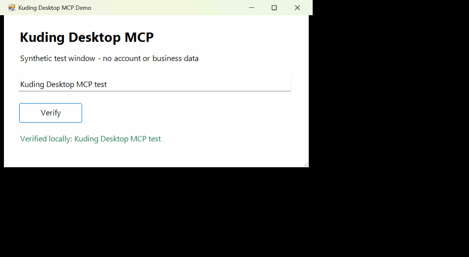

# Kuding Desktop MCP · 苦丁茶桌面 MCP

[English](README.md) | **简体中文**

为 AI 助手提供 Windows 桌面的观察、定位、操作与验证能力。基于 [CursorTouch/Windows-MCP](https://github.com/CursorTouch/Windows-MCP) **0.8.5** 的增强版本，通过本地 MCP stdio 服务工作，采用 MIT 许可。

## 为什么开发它

项目开始时，我们已经在使用 ChatGPT 的电脑控制插件。同时，我们使用的 WorkBuddy 环境中还缺少专门控制本地电脑的插件或 MCP，因此希望其他支持 MCP 的 AI 客户端也能协助操作 Windows 软件。

在实际任务中，我们还遇到应用适配、工具可用范围和操作方式方面的限制，因而希望拥有能够自行检查代码、调整功能、积累软件操作经验的工具。Kuding Desktop MCP 为不同客户端和应用场景提供补充；它遵循 AI 客户端自身的权限和审批规则。

完整介绍见 [项目缘起与开发过程](docs/introduction.zh-CN.md)。

## 增加了哪些能力

| 环节 | 主要能力 |
|---|---|
| 观察 | 控件树中的文本节点、聚焦窗口读取、按窗口截图、屏幕坐标和缩放提示 |
| 定位 | 按进程、窗口、控件名称、类型、AutomationId 限定查找范围 |
| 操作 | 原生 UIA 写值与动作调用，以及鼠标、键盘、拖拽和窗口管理 |
| 自绘界面 | Windows 本地 OCR、文字定位、颜色与区域辅助查找 |
| 验证 | 截图坐标的窗口归属检查、操作后观察、条件等待和结果说明 |
| 协作 | 同桌面输入互斥、检测真人输入后让路、可见操作提示和 Esc 叫停 |
| 使用经验 | 随附通用操作 skill，以及脱敏后的应用案例和限制说明 |

工具名和参数以客户端发现的 `tools/list` 为准。输入互斥只协调使用相同机制的实例，无法阻止所有第三方自动化；Esc 也不能撤销已经执行的动作。



上图来自本次公开版实际通过 MCP 操作的专用测试窗口：定位编辑框、写入并回读测试文字、调用 Verify 按钮后确认结果。画面仅含合成数据。[步骤与证据](docs/examples.zh-CN.md)。

## 隐私：移除上游自动遥测

我们采用的上游 0.8.5 版本含有 PostHog 使用统计和错误报送实现。公开版用本地诊断实现替换其发送逻辑，省略 PostHog SDK，并在启动前检查替换是否生效。兼容类名保留，以维持上游工具的调度接口。

**工具不会通过原有 PostHog 机制自动向上游统计服务发送工具调用或错误信息。公开版也不包含内部机器日志回传流程。** 问题反馈由使用者主动提交。

本地错误日志可能含窗口标题或文件路径；分享前请脱敏。AI 客户端可能把工具返回的截图和文字交给其模型服务处理，这由客户端设置决定。安装、更新需要下载依赖；显式启用的联网工具也有自己的网络行为。详见 [隐私与权限边界](PRIVACY.md)。

## 支持环境

- 面向 Windows 10/11 x64；本次公开版安装与协议验证在 Windows 11 x64、CPython 3.13 上完成。Windows 10 与 ARM64 尚未完成独立验证。
- 安装器使用 [uv](https://docs.astral.sh/uv/getting-started/installation/) 创建独立 Python 3.13 环境，安装时需要联网。
- UI 操作需要已登录、解锁的交互桌面。OCR 需要 Windows 相应语言的识别支持。
- 开发记录中在 Claude Code、Codex、WorkBuddy、OpenCode 环境使用过这套工具；本次验证范围和证据见 [验证说明](docs/validation.md)。配置文件通常需要合并后重启客户端生效。

## 安装与自检

先安装 uv，再从本仓库克隆代码，或下载 GitHub Release 的源码压缩包并解压。PowerShell 中进入项目目录执行：

```powershell
powershell -NoProfile -ExecutionPolicy Bypass -File .\install.ps1
```

默认安装到 `%LOCALAPPDATA%\KudingDesktopMCP`，与旧内部版安装分开。安装器不会改动 AI 客户端配置，也不会创建开机启动或定时任务。依赖锁包含 SHA-256 校验值，安装使用显式依赖清单；上游分析发送模块在 MCP 启动前被替换。

成功后会输出 `ok: true`、工具数量及 `missing: []`。自检只进行 MCP 初始化和工具发现，不点击、读取桌面内容或操作业务软件。

自定义目录、升级、卸载和网络参数见 [安装维护说明](docs/installation.zh-CN.md)。

## 接入 AI 客户端

读取安装器生成的配置：

```powershell
Get-Content "$env:LOCALAPPDATA\KudingDesktopMCP\mcp.json"
```

将其中的 `kuding-desktop` 服务合并到客户端的 MCP 配置。不要覆盖原来其他 MCP 条目。下面路径中的 `<YOUR_USER>` 需要替换成自己的 Windows 用户目录：

```json
{
  "mcpServers": {
    "kuding-desktop": {
      "command": "C:\\Users\\<YOUR_USER>\\AppData\\Local\\KudingDesktopMCP\\venv\\Scripts\\python.exe",
      "args": ["C:\\Users\\<YOUR_USER>\\AppData\\Local\\KudingDesktopMCP\\serve.py"]
    }
  }
}
```

Claude Code、Codex TOML、WorkBuddy 及 OpenCode 的配置示例见 [客户端配置](docs/clients.md)。不需要内部授权 key、分发站账号或任何模型 API key 来启动这个 MCP；AI 客户端使用模型的账号与费用另由客户端管理。

## 第一个练习

连接后可以给 AI 这段指令：

> 请使用 Kuding Desktop MCP 打开一个新的记事本窗口，确认这个窗口的身份，在空白编辑区输入“Kuding Desktop MCP 测试成功”，再读取编辑区核对。请保留结果让我查看，不保存文件，不操作其他已打开的记事本。

示例提示词不代表自动验收结果。开发期间的 Power BI、聊天软件自绘界面和 EasyVMS 案例，以及无个人数据的流程示意见 [案例与演示](docs/examples.zh-CN.md)。

## 已知限制与排查

- 最小化、锁屏、窗口遮挡、独立弹窗都可能使目标无法读取或点击，先枚举窗口并确认状态。
- 某些 Electron/WebView/Qt 界面提供的控件信息有限，需要结合应用版本、无障碍设置、OCR 和截图处理。
- OCR 会漏字或误认，读取结果应结合界面核对；同一窗口内容改变时，frame 检查不能识别全部内部变化。
- 普通权限服务通常不能驱动高权限窗口；UAC、安全桌面和用户登录授权交给使用者处理。
- 本工具是权限能力较大的本地服务。默认不开放 `PowerShell,Registry,FileSystem,Process,Scrape`，需要时可按文档显式调整。应用启动和桌面输入本身仍可能产生实际影响。

详见 [常见问题](docs/troubleshooting.zh-CN.md)。

## 来源、许可和参与

感谢 Windows-MCP 原作者及贡献者。原作者版权与 MIT 文本保留在 [上游许可](pkg/LICENSE-windows-mcp.txt)，本项目与新增改动采用 [MIT License](LICENSE)。[第三方组件清单](THIRD_PARTY_NOTICES.md) 列出安装器获取的依赖及其许可信息。

这是从内部版本整理、脱敏后建立的公开仓库。内部业务资料、诊断截图、机器标识、分发服务和原始内部提交历史不随公开版本发布。

欢迎提交实际场景中的问题，附软件版本、复现步骤、预期/实际结果和脱敏后的输出。代码贡献方法见 [CONTRIBUTING.md](CONTRIBUTING.md)，版本变化见 [CHANGELOG.md](CHANGELOG.md)。
