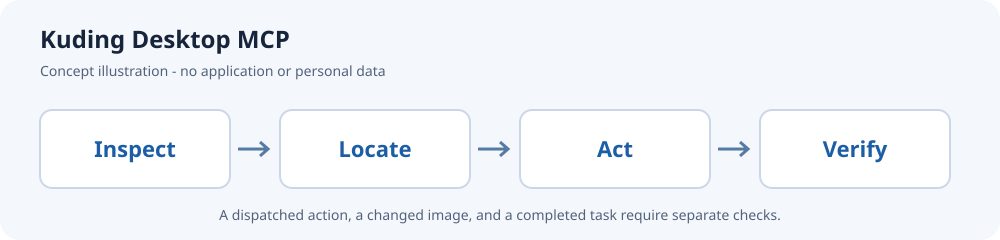
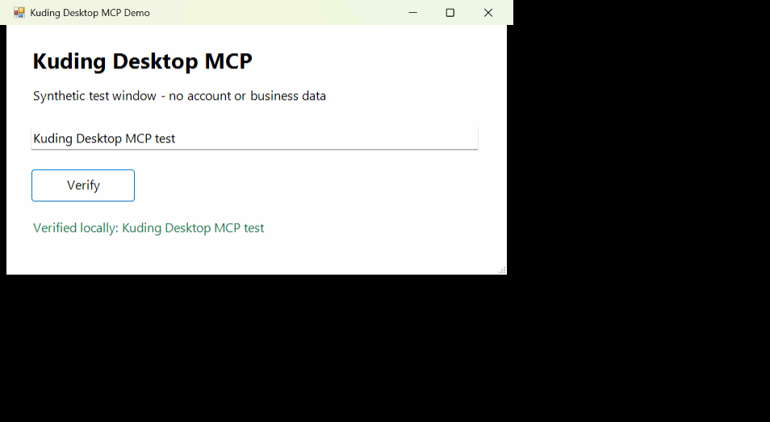

# 案例、示意和第一个练习

以下历史案例来自开发记录；并不表示所有软件版本、所有机器都能直接复现。本次公开版本的验证单独列在 [validation.md](validation.md)。原始业务截图、聊天记录和导出文件不公开。

## Power BI：原生控件定位

在制作看板的任务中，按进程收窄控件查找范围，定位数据面板和复选框，优先使用原生 UIA 动作。这个案例推动了按窗口/进程查找，以及更明确的最小化、空树等错误说明。

## 聊天软件：自绘界面

部分区域缺少可用控件树，结合窗口截图、文字 OCR、目标窗口归属和操作后观察完成操作。这个案例暴露了坐标缩放、遮挡、同名文字和独立弹窗等问题。公开版提供通用定位方法；涉及发送或删除等操作仍须遵循明确授权。

## EasyVMS：界面导出

在缺少适用导出接口的客户端中，通过可见界面执行筛选与导出。这个案例推动了控件树文本节点补充、等待界面状态和结果核对。内部设备、业务目录、导出数据及账号信息不随仓库发布。

## 流程示意

下面是无个人信息的概念示意，**不是实机操作截图或性能证明**：



## 可自行复现的记事本练习

前提：已安装、连接本 MCP，桌面已解锁，AI 客户端已获得此次操作授权。

1. 请 AI 打开一个新的记事本窗口，并用 `Window` 确认目标。
2. 用限定窗口/进程的 `Find` 观察编辑区。
3. 对支持写值的控件使用 `SetValue`；否则根据现场选择输入方式。
4. 输入一段无个人信息的测试文字，再读取编辑区核对。
5. 保留结果供使用者查看。完成后自行关闭新建测试窗口，不保存，不触碰已有文档。

如果控件树不完整，记录记事本与 Windows 版本，保留脱敏后的错误说明。工具发出输入并不等于文本核对成功；请报告实际完成的步骤。

## 本次实际运行的合成窗口演示

公开版在 Windows 11 x64 上通过自己的 MCP 服务操作了仓库内 `tests/fixtures/demo.ps1` 创建的原生 WinForms 测试窗口：

1. `Window` 找到并置前专用测试窗口。
2. `Find` 定位带名称的原生编辑框。
3. `SetValue` 写入测试文字，返回值回读一致。
4. `Invoke` 调用 Verify 按钮；测试窗口的事件处理确认收到预期文字。
5. `Screenshot` 仅截取该测试窗口。核对完毕后关闭自己的测试窗口。



这是**真实运行工具后对合成测试窗口的截图**，没有使用业务账号或业务数据。它证明上述限定步骤完成，不代表微信、Power BI 等完整业务流程在本次重新验收。[结构化证据](demo-evidence.json)。

手动复现需明确允许操作桌面：

```powershell
& "$env:LOCALAPPDATA\KudingDesktopMCP\venv\Scripts\python.exe" tests/manual_desktop_demo.py --runtime "$env:LOCALAPPDATA\KudingDesktopMCP" --output '.\demo-output' --run-desktop-demo
```

选择不存在或空的输出目录。此测试会打开并操作自己的合成窗口，完成后关闭该窗口；请先确保桌面空闲。安装器和 CI 不自动执行这项桌面演示。
